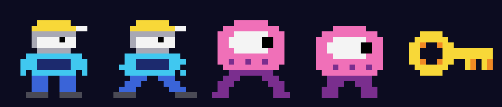
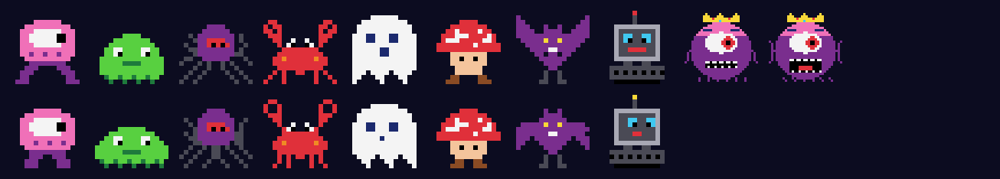
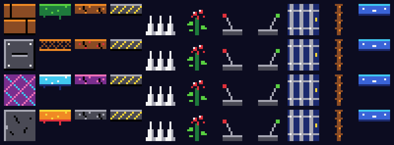

# Cavern Runner

A Manic Miner style scrolling platform game for Windows, written in plain C++
with the Win32 API and GDI - no game engine, no extra libraries.

Collect every flashing key, then reach the exit before your air runs out.
Ten caverns of conveyors, crumbling floors, ropes, moving platforms, switches,
poison plants and patrolling monsters - and sometimes the Guardian turns up.

## Features

- **Ten caverns**, getting harder as you go, in four tile sets
- **Sixteen monster designs** that walk, run, fly, go up and down, or bounce
- **Ropes, moving platforms, conveyors, crumbling floors, switches and doors**
- **A random boss** that hunts you through walls for 20 seconds
- **Music and sound effects** from a small built-in mixer: *The Entertainer*
  (Joplin), *Deep Down* (an original) and *In the Hall of the Mountain King*
  (Grieg); the music speeds up as your air runs out
- **Extra lives** every 10,000 points and a **high-score table** with names
- **A demo mode** that plays the game by itself on the title screen
- **Gamepad support** (Xbox-style controllers, through XInput)
- **A resizable window**, and full screen with F11

### Built-in editors

- **Cavern editor** (E on the title screen) - paint caverns with the mouse,
  choose monsters, tiles and music, test-play straight away, and press **V**
  to *check* a cavern: it explores every place the player can reach using the
  game's own physics, and marks unreachable keys and one-way drops
- **Designer** (C) - a pixel editor for the characters, monsters, boss and
  all four tile sets
- **Sound designer** (A) - edit every sound effect and the tunes

Everything you make is saved as plain text next to the program
(`caverns.txt`, `sprites.txt`, `sounds.txt`), so you can also edit it in
Notepad.

## Building

You need [Dev-C++](https://github.com/Embarcadero/Dev-Cpp) (the Embarcadero
version, 6.3 or later) on Windows.

1. Download or clone this repository into a folder of its own.
2. Open `Cavern.dev` in Dev-C++.
3. Press F11 (Compile & Run).

The project links with `-static` and `-lwinmm`. If Dev-C++ ever reports
`undefined reference to waveOutOpen`, add `-lwinmm` under
Project > Project Options > Parameters > Linker.

It's ordinary Win32 C++, so other MinGW-w64 compilers work too, e.g.

    g++ -O2 *.cpp cavern.res -o Cavern.exe -mwindows -static -lwinmm

(after compiling `cavern.rc` with `windres cavern.rc -O coff -o cavern.res`).

## Playing

| Key | |
|---|---|
| Left / Right | walk |
| Space or Up | jump |
| Up / Down | climb ropes |
| P | pause |
| S / M | sound effects / music on or off |
| F11 | full screen |
| H | high scores (on the title screen) |
| Esc | back to the title, or quit |

On a gamepad: the stick or d-pad moves, A jumps, Start starts, B pauses.

## The code

| File | |
|---|---|
| `cavern.h` | what all the parts share: sizes, types, shared variables |
| `main.cpp` | the window, the game loop, keyboard, mouse and full screen |
| `game.cpp` | the rules: player physics, ropes, platforms, monsters, boss |
| `draw.cpp` | drawing the game, the status strip, title and high scores |
| `editor.cpp` | the cavern editor |
| `designer.cpp` | the pixel editor for characters and tiles |
| `audio.cpp` | the sound designer |
| `checker.cpp` | the cavern checker, and route planning for the demo |
| `demo.cpp` | the demo |
| `files.cpp` | reading and writing `caverns.txt` and `sprites.txt` |
| `scores.cpp` | the high-score table |
| `sound.cpp` | the sound mixer, effects and music, and `sounds.txt` |
| `pad.cpp` | gamepads |
| `inputbox.cpp` | a small "type some text" window |
| `defaults.cpp` | the standard caverns, artwork and sounds |
| `cavern.rc`, `cavern.ico` | the icon and version information |

## Licence

MIT - see [LICENSE](LICENSE). The tunes by Joplin and Grieg are long out of
copyright.
